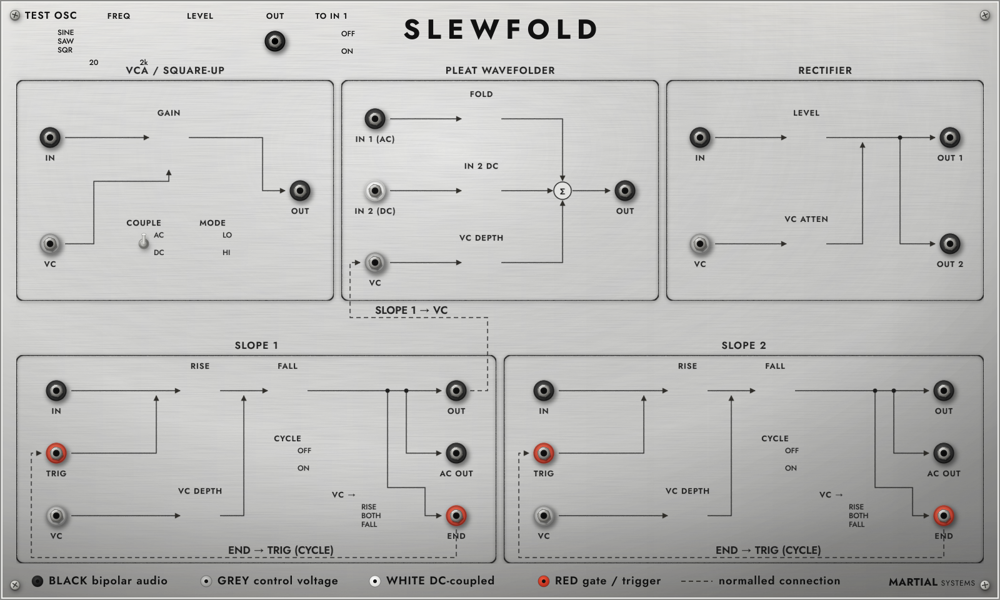

# SLEWFOLD

SLEWFOLD is the Wave Multipliers module and two slope sections in one VST3. The bundle id, the manufacturer code, and the unique id are unchanged (`PLUG_MFR_ID` `'Mrsy'`, `PLUG_UNIQUE_ID` `'SmCb'`). `SergeMiddle/` and `SlopeAC/` stay the single-panel plugins.

The plate is the hand-drawn 1600 by 960 face (`resources/slewfold_v6.svg`). Knobs are not in the bitmap: `tools/art/render_slewfold.py` removes the knob groups, the LED groups, and the moving switches, then `rsvg-convert` writes `slewfold_plate.png` and the @2x plate. The editor draws each knob from `knob_filmstrip.png` (64 frames, -135 to +135 degrees, 72 px at 1x) at the ids_v6 centre. Hovering a knob writes its value into that knob's readout rect. Toggles and the slope lamps are drawn live. The top COUPLE lever is drawn on the plate and is not a parameter. END lamps follow the END jack. Cycle lamps light while Cycle is on and that slope's OUT is at or above 2.5 V.

Window: 1440 by 864, scaling from 1200 by 720 up to 2400 by 1440. The corner resizer and the host resize keep that aspect. The default fits a 1920 by 1080 screen with the Dock. The minimum fits a 1280 by 800 screen. The plate art stays 1600 by 960 and is fitted into the window. Format: VST3, via Unix Makefiles. Black jacks are bipolar, grey jacks are unipolar CV, the white jack is the DC-coupled input, and red jacks are trigger or gate. Top Gain and Bottom Level read `0` at the counterclockwise stop, the same `0` as the tick, not `0.000`.



## Parameters

| Index | Name | Law |
| --- | --- | --- |
| 0 | Fold | 0.5 to 8, default 1, exponential, same knob as PLEAT |
| 1 | IN 2 DC | -2.5 V to +2.5 V, default 0, same knob as PLEAT |
| 2 | VC Depth | 0 to 1, default 0.5, linear |
| 3 | Rise | 0.0001 s to 10 s, default 5 ms, same display as Slope AC |
| 4 | Fall | 0.0001 s to 10 s, default 5 ms, same display as Slope AC |
| 5 | Cycle | off by default |
| 6 | Slope VC | -1 to +1, default 0, linear. Attenuverter in front of the slope VC jack |
| 7 | Route | 0 RISE, 1 BOTH, 2 FALL, default BOTH |
| 8 | Top Gain | 0 to 1, default 0, linear, smoothed 20 ms |
| 9 | Top HI | off is LO, on is HI, default LO |
| 10 | Bottom Level | 0 to 1, default 0, linear, smoothed 20 ms |
| 11 | Bottom VC | 0 to 1, default 1, linear, smoothed 20 ms. Attenuator in front of the bottom VC jack |
| 12 | Rise 2 | 0.0001 s to 10 s, default 5 ms, same law as Rise |
| 13 | Fall 2 | 0.0001 s to 10 s, default 5 ms, same law as Fall |
| 14 | Cycle 2 | off by default. Same arm as Cycle, for slope 2 |
| 15 | Slope VC 2 | -1 to +1, default 0, linear. Attenuverter in front of slope 2 VC |
| 16 | Route 2 | 0 RISE, 1 BOTH, 2 FALL, default BOTH |

Fold and IN 2 DC are smoothed once per audio sample, shared by the left and right channels, and held across the four oversampled phases. Top Gain, Bottom Level, and Bottom VC use that same 20 ms smoother, also shared, and Reset starts them at the target so a constant knob is exact from the first sample. Rise, Fall, Slope VC, and Route are read per sample. Cycle is read once per block. VC Depth is read once per block and is not smoothed. Slope VC and Route were appended after Cycle so a project saved before them restores the first six parameters and loads these two at the defaults. Top Gain through Route 2 were appended after Route, so a project saved before them keeps the first eight and loads the new knobs at the defaults. Default 0 and BOTH pass no slope VC, which is the unpatched jack. Bottom VC defaults to 1, so a patched bottom VC is full scale until the attenuator is turned down.

## Jacks

Inputs and outputs are separate lists.

| Input | Coupling when a cable is present |
| --- | --- |
| PLEAT IN 1 | AC coupled by the 10 Hz block, then the drive |
| PLEAT IN 2 | DC coupled. Not smoothed. Own 63-tap upsampler. Clamped to ±10 V |
| PLEAT VC | Volts into the fold law below. Not smoothed |
| SLOPE IN | Volts into the slope input. No extra gain |
| SLOPE TRIG | Volts. A rising edge starts a slope. A level that has stayed high since that edge holds at +5 V until it goes low. A later pulse does not hold, and a new edge is ignored until the output is back at 0 V. A signal on SLOPE IN overrides TRIG |
| SLOPE VC | Volts into the slope time control, after the Slope VC attenuverter and the Route switch |
| TOP IN | AC coupled by the 10 Hz block, then the top VCA |
| TOP VC | Volts added to Top Gain. +5 V adds 1. Not smoothed. No attenuator knob |
| BOTTOM IN | AC coupled by the 10 Hz block, then the rectifier |
| BOTTOM VC | Volts added to Bottom Level, after the Bottom VC attenuator |
| SLOPE 2 IN | Volts into the second slope input. Same circuit as SLOPE IN |
| SLOPE 2 TRIG | Volts. Same trigger rules as SLOPE TRIG. No MIDI normal |
| SLOPE 2 VC | Volts into the second slope time control, after Slope VC 2 and Route 2 |

| Output | Voltage |
| --- | --- |
| PLEAT OUT | 2.5 times the PLEAT host sample, after the output 10 Hz block |
| SLOPE END | 0 V or +5 V. +5 V while the circuit end gate is high and slope OUT is below 4 V. Otherwise 0 V. Idle, with OUT at 0 V, is +5 V. The same `EndJackVolts` law as the standalone slope |
| SLOPE OUT | The slope sample, 0 V to +5 V |
| SLOPE AC | The 10 Hz block of (circuit AC - 2.5), in volts. Circuit AC is 2.5 - OUT |
| TOP OUT | The top section, after its 10 Hz block, hard-clamped to ±5 V |
| BOTTOM OUT 1 | Level-compensated full-wave output, after its own 10 Hz block, hard-clamped to ±5 V |
| BOTTOM OUT 2 | The squared-up version of OUT 1, own 10 Hz block, hard-clamped to ±5 V |
| SLOPE 2 END | Same END law as SLOPE END, from slope 2 |
| SLOPE 2 OUT | The second slope sample, 0 V to +5 V |
| SLOPE 2 AC | The 10 Hz block of (slope 2 circuit AC - 2.5) |

Host ±1 is ±2.5 V, the PLEAT Serge level. An unpatched PLEAT IN 1 does not round-trip through that scale: the host sample goes straight into the same drive as the PLEAT plugin. PLEAT OUT in volts is 2.5 times the sample that also goes to the host.

Slope IN volts go straight into the slope input. There is no 5x host scaling on that jack. Slope VC volts are multiplied by the Slope VC attenuverter, then they go into the slope VC on the segment Route selects. Depth 0, the default, passes 0 V, so the jack does nothing until the knob moves. Depth +1 is the unscaled jack. Depth -1 inverts it. Route defaults to BOTH. 1V/oct stays at 0. Feedback stays at 0. The circuit is the second half.

The circuit end gate is still 0 while falling and 1 otherwise. The Cycle switch reads that gate inside the circuit. The END jack is a separate 5 V logic output with the GTS window. The Serge GTS manual, page 5, says END goes high at the end of the fall and stays high for about 80% of the rise. On a straight line from 0 V to 5 V, 80% is 4 V. A jack that stayed high for the whole rise, patched to TRIG, would meet the hold rule and sit at +5 V. The window drops the jack to 0 V once OUT reaches 4 V, so that cable cycles instead. At 48 kHz, with rise and fall at 5 ms, the END to TRIG cable repeats every 481 samples. The Cycle switch repeats every 480 samples. The cable is one sample longer: the jack goes high on the idle sample after the fall, and TRIG reads that high on the next sample.

## Normals

Zero cables is a complete instrument. A cable in an input breaks that input's normal.

| Normal | What the jack receives |
| --- | --- |
| Host audio to PLEAT IN 1 | Volts are 2.5 times the host sample. The path is the PLEAT plugin: 10 Hz IN 1 block, then the drive |
| IN 2 DC knob to PLEAT IN 2 | Smoothed, held across the four phases, and C^6(s) is subtracted. A cable replaces the knob: the voltage is DC coupled, not smoothed, upsampled by its own 63-tap filter with the same zero stuffing as the drive, added on each phase, and C^6(s) is not subtracted. A patched IN 2 is clamped to ±10 V. A non-finite cable reads as 0 |
| Slope OUT to PLEAT VC | The previous sample of slope OUT, through VC Depth. VC Depth applies to a cable on this jack as well |
| Host MIDI gate to slope TRIG | Any note held is 5 V. No notes is 0 V. The edge is the sample the message is stamped with. The sustain comes from that voltage still being high at +5 V, not from a DAW-specific hold. All-notes-off, CC 123, releases. A note-on with velocity 0 is a note-off. A TRIG cable breaks this normal |
| Cycle switch is the END to TRIG cord | The cord is on while the switch is on. Turning it on arms one trigger, including after reset while it is already on. It runs together with whatever voltage is on TRIG |
| Slope IN and slope VC are 0 V unpatched | Host audio is not normalled to slope IN |
| PLEAT OUT to the host | Always. A cable from PLEAT OUT to another jack does not mute the host |
| Top IN, top VC, bottom IN, and bottom VC are 0 V unpatched | No normal between VCM sections. Host audio is not normalled to them |
| Slope 2 IN, TRIG, and VC are 0 V unpatched | The MIDI gate stays on slope 1. Slope 2 OUT is not normalled to PLEAT VC |

## Routing

One cable per input. An output may feed any number of inputs, drawn as a stack. A new cable runs from an output to an input. A new cable into an occupied input replaces the old one. Inputs do not sum, so a second cable is not stacked on an input. A drag from an output always starts another cable, even when the output already has cables, so cables stack like Serge banana plugs and each stacked plug sits 6 px higher. To move a cable, drag its input end: dropping that plug on empty space unplugs it, and dropping it on another input moves it. Hovering an output says "drag to patch, more cables stack". Right-click a jack to unplug that jack, or to unplug all.

The cable drawing is Lift's (repository `martialsystems/lift`, branch `tape-engine-juce`): `panel/CableRope.h` for the rope, `panel/LiftPanelPaint.cpp` for the cloth, the dashes, the plugs, and the in-hand cubic, `panel/PanelData.h` for the six cloth colours, `panel/PaintUtil.h` for the grey used while a cable is carried, and `panel/LiftPanel.cpp` for the 6 px stack step. Audio outputs use the cream cloth. END outputs use the red cloth. Each extra plug on an output sits 6 px higher and the plugs under it are drawn open, the way Lift draws a stackable plug. The rope is 36 nodes, gravity 0.45, damping 0.985 then 0.9, ten constraint passes, slack `d + min(0.3 d + 40, 140)`. A new rope is settled before it is shown. Dropping or moving a cable then kicks that rope, and the UI steps it twice a frame on the 0.9 damping until it has stayed under 0.03 px for 20 frames. The redraw for that layer stops there. The routing bytes are not extended, so a project saved by the previous editor still loads: colour, sag, and stack level are derived from those bytes.

Every jack-to-jack transfer reads the source from the previous sample. That one-sample delay covers cables and the slope OUT normal, so a feedback patch is defined and does not depend on which jack is stepped first. Host audio into an unpatched PLEAT IN 1 is the same sample. PLEAT OUT back to the host is the same sample. The MIDI gate into an unpatched TRIG is the same sample.

The UI writes one atomic byte per input. The audio block copies those bytes once, then uses that copy for every sample in the block. Hover meters are the minimum and maximum of channel 0 over the last block. A spread above 0.05 V draws as a range, for example `SLOPE END  +0.00 .. +5.00 V`. A tighter block draws as one voltage, for example `SLOPE END  +5.00 V` at idle. Cable colour follows the output, so unplugging one cable leaves the colours of the others.

## VC law

This is a modelling choice. The manuals say FOLD sets the baseline as CV is added on top (La Bestia 3, page 20). They do not give a volts-per-fold figure. The law here adds the attenuated jack to the fold amount:

```text
g = clamp(g_s + depth * VC, 0.5, 8)
```

`g_s` is the smoothed Fold knob. `VC` is volts on PLEAT VC. `depth` is VC Depth, clamped to the range 0 to 1. One volt at depth 1 adds 1 to the fold amount, so a 0 V to +5 V slope moves Fold 1 up to 6. VC is not smoothed: the hardware VC takes audio. `g` is computed once per audio sample and held across the four phases. A VC of 0, or a depth of 0, returns `g_s` with no addition, so the smoother value reaches the cells unchanged. A non-finite VC or depth is treated as 0.

PLEAT OUT is then hard-clamped to ±5 V. A sample already inside that rail is left as the cell path produced it, so an unmodulated Fold matches the standalone PLEAT plugin bit for bit. The clamp is what keeps a moving fold amount on the jack: the level correction assumes a steady `g`, and the decimator still holds a few samples of the previous amount.

VC Depth is the modern-panel addition. The original 1970s VCM middle section had no VC attenuator. Current official Serge panels do: La Bestia 3, page 20, "MID AU", and the Random*Source VCM.

## MIDI

The gate is a bitmask of note numbers. A second note-on does not count twice. A second note-off does not step below zero. Messages are queued from ProcessMidiMsg and applied inside the block at their sample offset.

FL Studio does not send notes to an effect until the wrapper has a MIDI input port. Open the plugin wrapper on the mixer slot, or on the channel, and set MIDI input port.

Reset clears the MIDI queue and releases every held note. A transport stop that resets the plugin cannot leave TRIG stuck high. The slope trigger memory is cleared with the channels, so the next note is a new edge.

## State

The chunk is the parameter block, then the routing bytes. Magic is 0x52. The current blob is version 2, input count 13, then one source byte per input in the input order above (16 bytes). 255 means unpatched. A source byte is one of the outputs: 0 PLEAT OUT, 1 slope END, 2 slope OUT, 3 slope AC, 4 TOP OUT, 5 BOTTOM OUT 1, 6 BOTTOM OUT 2, 7 slope 2 END, 8 slope 2 OUT, 9 slope 2 AC. A project saved before these jacks is version 1, count 6, nine bytes, sources 0..3 only. That blob still loads, and the inputs added after slope VC stay unpatched. A tail shorter than nine bytes, a bad magic, a bad version, a bad count, or a source outside the outputs of that version leaves every input unpatched. A longer tail is accepted: a version 1 header consumes nine bytes, a version 2 header consumes 16, and anything after them stays in the chunk. If the UI is open, it reads the routing again after the chunk loads.

## Build

From the repository root. This configure does not copy the bundle into the user VST3 folder:

```text
cmake -S SergeMiddleCombined -B build/SergeMiddleCombined -G "Unix Makefiles" -DCMAKE_BUILD_TYPE=Release -DIPLUG_DEPLOY_PLUGINS=OFF
cmake --build build/SergeMiddleCombined --target SergeMiddleCombined-vst3
bash SergeMiddleCombined/dsp/tests/run_tests.sh
```

The universal FL Studio bundle is in `BUILD.md`.

## Limits

A TRIG voltage that has stayed high since the edge that started the rise holds the output at +5 V until the voltage goes low. A pulse that arrives later, including one that lands on the sample the rise finishes, does not hold. The END jack is 0 V for that hold, because OUT is not below 4 V. A voltage that has already gone low, including one that drops before OUT passes 4 V, does not hold: the rise finishes and the fall starts. The 4 V mark is only the END jack window. It is exact on the 5 ms stair at 48 kHz. A 4.5 V compare is not, because 5 * (216 / 240) is not a binary 4.5. A positive SLOPE IN overrides the TRIG hold and the slope slews to that input.

The host is told 16 samples of latency, the same figure as the PLEAT plugin. The two 63-tap filters delay 31 + 31 samples at the four-times rate, which is 15.5 audio samples.

Slope IN other than 0 V takes the input path and does not also inject the TRIG edge. Cycle can still arm, and the circuit ignores that edge while the input is away from 0 V.

## Top and bottom

This is a modelling choice. The notes name the top as a VCA or a soft square-up with a HI/LO switch, and the bottom as a level-compensated full-wave rectifier with a second squared output. They do not give a schematic, a time constant, or a drive figure.

Top LO is linear: the smoothed gain times the AC-coupled input. Unity is gain 1. Top HI is `2.5 * tanh(3 * g * x / 2.5)`, an odd soft square. At ±2.5 V and gain 1 the tanh drive is 3, so the wave sits just inside ±2.5 V before the output block. The gain knob is the baseline. Top VC adds volts/5 with no attenuator knob. The factory VC attenuator mod is the middle and the bottom, not the top. +5 V at gain 0 is the same control as gain 1. The input and the output each have the PLEAT 10 Hz block. The output is then hard-clamped to ±5 V. A sample already inside the rail is unchanged. The COUPLE switch on the 2022 panel is drawn, lever at AC, and it is not a parameter: the original top input is the black AC jack, so the path stays AC coupled.

Bottom LEVEL is the unnamed original pot, 0 at full CCW. The VC attenuator defaults to 1, which is the original unattenuated VC jack. `ctrl = clamp(level + depth * VC / 5, 0, 1)`. The input is AC coupled. The rectifier is `abs(ctrl * x)`. A linear peak follower (attack 1 ms, release 30 ms) tracks that. While the envelope is at or below 0.02 V the section is silent, so a cold start at gain 0 or input 0 is exact 0 and a tiny input is not boosted into noise. Above the floor, `norm = min(rect / env, 1)`, and OUT 1 is the 10 Hz block of `4 * tanh(ctrl * 2.5 * norm)`, clamped to ±5 V. OUT 2 uses the same wave through `tanh(8 * shaped)` and its own block, on the same 4 V scale. The compensation follows the input amplitude. The knob still sets how hard the tanh is driven. +sine and -sine take the same path.

## Slope 2

Slope 2 is the same circuit as slope 1: rise, fall, Cycle, VC attenuverter, RISE/BOTH/FALL, and the six jacks. It has its own state. It does not add a 1V/OCT jack, a separate rise CV, or a pulse output. Those are on a full GTS and they are not on slope 1, so copying slope 1 leaves them off here too. Cycle 2 is the END to TRIG cord inside slope 2. Nothing normals slope 2 OUT into PLEAT VC. That normal stays on slope 1.

## Gaps

There is no 1V/OCT jack. The top COUPLE switch is drawn and is not in the audio path: top IN stays on the 10 Hz block. One input takes one cable: several cables are not stacked on one input. An output does stack. Host audio reaches slope IN only by a cable, with no host sidechain. The editor was not host-tested by the agent. The standalone slope has the same attenuverter and route switch, and its VC jack voltage is 0 V because that plugin has no patch bay. Host ±1 stays ±2.5 V, the locked PLEAT level. The new jacks use that same volt domain. They are not rescaled to a host sample of ±5 V.

Copyright (c) 2026 Martial Systems LLC. All rights reserved.

## Test oscillator

A small TEST OSC strip sits at the top left of the plate: a SINE / SAW / SQR lever, FREQ (20 Hz to 2 kHz, default 110 Hz), LEVEL (-60 to 0 dB, where 0 dB is +/-5 V, default -12 dB, about +/-1.26 V), an OUT jack (black, bipolar), and a TO IN 1 lever. OSC OUT is a normal patch source. With TO IN 1 on (the default), the oscillator is the PLEAT IN 1 normal in place of host audio, so the panel sounds with no input. A cable into IN 1 always wins. Turn TO IN 1 off to hear host audio on an unpatched IN 1. This is the simplest choice: a toggle, not a silence detector. Saw and square edges use PolyBLEP.

## Starter patch

A fresh instance opens on a starter patch: the test sine at 110 Hz, -12 dB, cabled into PLEAT IN 1, Fold 2, VC Depth 0.5, and Slope 1 cycling (Rise 1.5 s, Fall 2.5 s) cabled into PLEAT VC, so the fold sweeps slowly. PLEAT OUT is the host output. The knob values are the parameter defaults, so right-click or double-click on a knob returns it to the starter value. The routing is set in the constructor, not in OnReset: hosts call OnReset on every sample-rate or transport change, and that must not wipe a user's cables. A saved project or saved app state replaces both.
